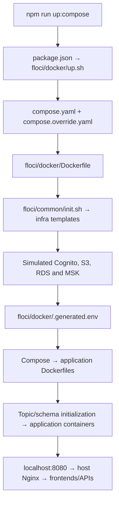
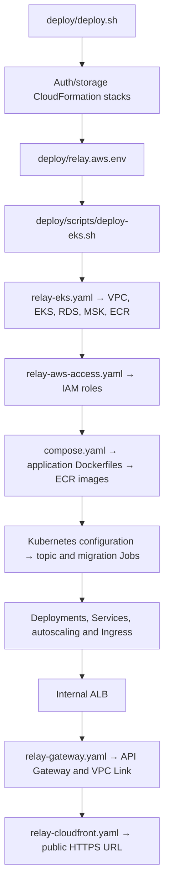
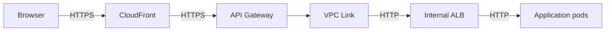

[](https://github.com/AY2627S1-CS3219-P9/Relay/actions/workflows/ci.yml)
[](https://github.com/AY2627S1-CS3219-P9/Relay/actions/workflows/floci-eks.yml)
[](https://github.com/AY2627S1-CS3219-P9/Relay/actions/workflows/load-tests.yml)

# CS3219 — Software Design and Architecture (AY2627 Sem 1)

## Relay

**Relay** is a peer-to-peer campus errand platform where
students can request items to be collected from stores or facilities on
campus, and other students can fulfil (and deliver) those requests. The
platform runs on a closed credit economy — credits cannot be bought,
withdrawn, or exchanged for money, and only circulate within the platform.

---

## Team Members

| Role/Name        | **Cai Zhouxuan**                      | **Ng Zhe, Javier**      | **Wong Rong Kang**                     | **Toh Jun Yeen, Ryan**        |
| ---------------- | ------------------------------------- | ----------------------- | -------------------------------------- | ----------------------------- |
| User Service     | User Authentication, Admin Management | User Profile Management |                                        | Frontend                      |
| Supplier Service |                                       |                         | Supplier CRUD                          | Frontend                      |
| Errand Service   |                                       | Errand CRUD             | Errand Courier Lifecycle, Kafka Events | Frontend                      |
| Credit Service   | Backend, Frontend                     |                         |                                        |                               |
| Misc             | Kafka Event Publishers, CD, IaC       | CI, Load Testing, Docs  | Errand Notification                    | Kubernetes, UI Contracts, IaC |
| N2H              | AWS Deployment, Kubernetes            | Grafana Load Testing    | Credit Estimation                      | Interactive Map               |

---

## Repository Structure

This repository follows a **one-service-per-folder** structure: each
microservice (`user-service/`, `supplier-service/`, `errand-service/`,
`credit-service/`) lives in its own top-level folder.

```text
.
├── user-service/
├── supplier-service/
├── errand-service/
├── credit-service/
├── credit-estimation-service/
├── errand-notification-service/
├── host/                   # Application shell
├── packages/               # Shared contracts, UI, auth, Prisma clients
├── floci/                  # Local environment launchers
├── infra/                  # CloudFormation templates
├── k8s/                    # Kubernetes manifests
├── deploy/                 # AWS deployment and lifecycle scripts
├── load-tests/
├── postman/
└── README.md
```

- Any **nice-to-have (N2H)** feature that warrants its own service should
  be added as an **additional folder** at the same level, following the
  same per-service structure.
- Files for agentic coding tools (e.g. agent configs, prompts, skills)
  may be added as needed, but must still **respect the
  one-service-per-folder skeleton** for core implementation.

---

## Deployment

### AWS deployment

From the repository root, run `AWS_PROFILE=user AWS_REGION=ap-southeast-1 bash deploy/deploy.sh relay`. The script guides SSO login, provisions the stacks, deploys the application, and prints its HTTPS URL. See [the deployment guide](deploy/README.md) for prerequisites, redeployment, pause, and teardown.

---

### Local deployment and development

Choose one startup path only.

Run commands from the repository root with Docker running and Docker Compose available.
Use Node.js 24 and run `npm ci` once.
Review the local settings in `.env.development` before starting.

On Windows, use WSL with Linux Node/npm (`source ~/.nvm/nvm.sh` if needed).

| Path | Application | Floci API | Best for |
| --- | --- | --- | --- |
| Simulated EKS with Floci | HTTPS CloudFront URL printed by startup | https://localhost:4567 | Kubernetes deployment and pod lifecycle checks |
| Docker Compose | http://localhost:8080 | http://localhost:4566 | Running the complete application in containers |
| Source development | http://localhost:8080 | http://localhost:4566 | Editing frontend and backend code locally |

#### Option 1: Simulated EKS deployment using Floci

Requires `kubectl` in addition to the common prerequisites.

```bash
npm run up:eks
```

This starts a separate Floci instance and provisions simulated Cognito, S3,
four RDS databases, MSK, and an EKS cluster backed by local k3s. It builds and
pushes application images to Floci ECR, configures Kubernetes secrets and AWS
service-account access, initializes Kafka topics and database schemas, deploys
the application and autoscaling, and sets up CloudFront/API Gateway/ALB routing.
Startup waits for the workloads and application health check.

Import `floci/eks/.floci-ca.pem` into your browser or OS trusted root store
once, restart the browser, and open the HTTPS CloudFront URL printed by the
script. The CA is retained across teardown and startup.

```bash
# Inspect the local cluster
kubectl --kubeconfig floci/eks/.kubeconfig -n relay get pods

# Stop and remove this environment, including its databases
npm run down:eks
```

#### Option 2: Docker Compose deployment

```bash
npm run up:compose
```

This starts Floci and provisions simulated Cognito, S3, four RDS databases,
and MSK. It discovers their generated settings, writes
`floci/docker/.generated.env`, and starts the complete application as Compose
services, including database initialization, Kafka topics, and event publishers.
Open http://localhost:8080. This path does not start Kubernetes.

```bash
# Stop and remove this environment, including its databases
npm run down:compose
```

Use the npm launcher rather than plain `docker compose up`: the launcher
supplies the database, Cognito, S3, and Kafka settings generated by Floci.

#### Option 3: Source development with npm run dev

```bash
# If the full Compose application is running, stop it first:
# npm run down:compose  # removes its local database data
npm run dev
```

This prepares Compose infrastructure, then runs the host and four frontend
remotes with Vite and the backend APIs, notification service, and two event
publishers from source. Authentication stays in a Compose container. It uses
Floci's generated database, Kafka, Cognito, and S3 settings and prepares the
database schemas automatically. Open http://localhost:8080.

`npm run dev` is a complete startup command; you do not need to run
`up:compose` or `up:eks` first. It shares ports with the full Compose app, so
stop that app before switching. To stop source development, press Ctrl+C;
run `npm run down:compose` afterward to remove the remaining infrastructure
and database data.

See the [local environment guide](floci/README.md) for script details,
rebuild options, optional Kafka/Prisma/Headlamp views, certificate rotation,
and differences between Floci and AWS.

---
## Deployment Flow

Local Compose and AWS deployment share the same application Dockerfiles.
Locally, Docker Compose runs the containers and Floci simulates AWS services.
On AWS, CloudFormation provisions the infrastructure, ECR stores application
images, and Kubernetes runs them on EKS.

### Local Docker Compose



1. **Launch and load the Compose files.** The `up:compose` script in
   [package.json](package.json) calls [floci/docker/up.sh](floci/docker/up.sh).
   Compose automatically combines [compose.yaml](compose.yaml), which defines
   application builds, configuration, health checks and dependencies, with
   [compose.override.yaml](compose.override.yaml), which adds Floci, local
   endpoints, development ports and optional inspection tools.

2. **Start Floci and provision simulated AWS resources.**
   [floci/docker/Dockerfile](floci/docker/Dockerfile) installs
   [floci/common/init.sh](floci/common/init.sh) as a startup hook. The hook
   applies [infra/relay-auth.yaml](infra/relay-auth.yaml) for Cognito,
   [infra/relay-storage.yaml](infra/relay-storage.yaml) for profile-image storage,
   and [infra/relay-floci-db.yaml](infra/relay-floci-db.yaml) for four PostgreSQL
   databases and supporting resources. It also creates simulated MSK through
   AWS API calls and bootstraps the local admin account. Floci backs its RDS
   and MSK emulation with local database containers and a Redpanda sidecar.

3. **Discover generated settings.** The launcher waits for Floci initialization,
   then reads the database credentials, Cognito IDs, bucket name and Kafka
   endpoints into `floci/docker/.generated.env`. Compose interpolation loads
   optional `.env`, then `.env.development`, then `.generated.env`; later files
   override earlier values. This discovery is why startup uses the npm launcher
   instead of plain `docker compose up`.

4. **Build images and initialize application data.** Compose follows each
   service's Dockerfile. For example, [host/Dockerfile](host/Dockerfile) builds
   the host frontend and packages it in Nginx, while
   [user-service/backend/Dockerfile](user-service/backend/Dockerfile) builds the
   User API and its shared packages. The `kafka-init` service runs
   [deploy/scripts/kafka-topics.mjs](deploy/scripts/kafka-topics.mjs) from the
   Credit API image. `supplier-schema` initializes Supplier's database, and
   the User, Errand and Credit API startup commands run Prisma migrations.
   Dependency conditions and health checks coordinate container startup.

5. **Serve the application.** At http://localhost:8080,
   [host/config/nginx.conf](host/config/nginx.conf) serves the host frontend
   and proxies `/remotes/*` and `/api/*` to the appropriate Compose services.
   Backend services use Compose service names to communicate with each other.

### AWS and Kubernetes

Start from the repository root:

```bash
AWS_PROFILE=user AWS_REGION=ap-southeast-1 bash deploy/deploy.sh relay
```



| Stage | Files and responsibility |
| --- | --- |
| Entry and initial configuration | [deploy/deploy.sh](deploy/deploy.sh) checks AWS access, applies the shared auth and storage templates, records their outputs in the ignored `deploy/relay.aws.env`, and bootstraps the first admin when needed. It then calls the EKS deployer. |
| AWS foundation | [deploy/scripts/deploy-eks.sh](deploy/scripts/deploy-eks.sh) applies [infra/relay-eks.yaml](infra/relay-eks.yaml), creating networking, EKS Auto Mode, four private RDS databases, three-broker MSK, ECR repositories and Metrics Server. |
| Application AWS permissions | [infra/relay-aws-access.yaml](infra/relay-aws-access.yaml) creates IAM roles linked to Kubernetes service accounts: User API accesses S3, and Auth API performs Cognito administration. |
| Image build and publishing | The deployer explicitly uses only [compose.yaml](compose.yaml) to build application images, excluding the local override. It pushes changed images to ECR and uses image digests in Kubernetes. Compose supplies build definitions; Kubernetes runs the AWS application. |
| Runtime configuration | [k8s/base/configmap.yaml](k8s/base/configmap.yaml) supplies common settings. The deployer reads AWS outputs and Secrets Manager credentials to generate Kubernetes Secrets, then fills IAM role placeholders in [k8s/base/serviceaccounts.yaml](k8s/base/serviceaccounts.yaml). |
| Initialization | [k8s/base/kafka-topics.yaml](k8s/base/kafka-topics.yaml) creates event and dead-letter topics; [k8s/base/migrations.yaml](k8s/base/migrations.yaml) runs database initialization Jobs. The deployer waits for completion before applying workloads and reuses completed Jobs when their inputs match. |
| Application execution | [k8s/base/workloads.yaml](k8s/base/workloads.yaml) defines Deployments, internal Services, configuration references and health probes. [k8s/base/autoscaling.yaml](k8s/base/autoscaling.yaml) supplies resource-based scaling; [k8s/base/keda-credit.yaml](k8s/base/keda-credit.yaml) also scales Credit using Kafka consumer lag. |
| Public access | [k8s/base/ingress.yaml](k8s/base/ingress.yaml) configures an internal ALB. Once its address exists, [infra/relay-gateway.yaml](infra/relay-gateway.yaml) creates API Gateway and its VPC Link, followed by [infra/relay-cloudfront.yaml](infra/relay-cloudfront.yaml) for public HTTPS. |

The browser request path is:



The ALB routes frontend and public API paths directly to their Kubernetes
Services; API requests bypass host Nginx. The deployer updates authentication's
public origin to the CloudFront URL, waits for application rollouts, checks the
public `/healthz` endpoint and prints the HTTPS URL. This endpoint checks the
host; application workflows still need separate verification.

Production service tokens are generated in Secrets Manager and injected through
`relay-service-tokens`; local simulated EKS creates that Secret with dummy values.
Optional production timeout, partition count and timezone overrides are read from
`deploy/relay.aws.env`. See [production configuration](deploy/README.md#production-configuration)
for the old/new flow comparison and portable verification command.

The production script renders image and role placeholders and applies the
manifests in order. It does not deploy the application through a Helm chart or
by applying `k8s/base/kustomization.yaml` directly.

### How the deployment targets differ

| Concern | Local Docker Compose | AWS Kubernetes |
| --- | --- | --- |
| Container execution | Compose services on your machine | Kubernetes Deployments and Jobs on EKS |
| AWS services | Floci emulation | Real Cognito, S3, RDS and MSK |
| Configuration | Local env files and generated Floci endpoints | ConfigMap, generated Secrets and IAM roles |
| Database initialization | Compose schema service and API startup commands | One-off migration Jobs before application rollout |
| Browser routing | HTTP through host Nginx | HTTPS through CloudFront, API Gateway and internal ALB |
| Event broker | One plaintext Redpanda broker managed by Floci | Three MSK brokers using TLS and SCRAM authentication |

`npm run up:eks` is a separate local Kubernetes simulation using Floci and k3s.
It exercises Kubernetes deployment locally; it does not provision real AWS
resources. See the [local environment guide](floci/README.md) and
[AWS deployment guide](deploy/README.md) for operational details.

---

## Local credit-allocation flow

Docker Compose provisions Floci MSK emulation, backed by a Redpanda sidecar.
Start Kafbat UI on demand with `npm run views:compose -- kafka` at
http://localhost:8081. In the development override, User API is
available to Postman at http://localhost:3001. Creating a verified user's
profile publishes `KAFKA_TOPIC_USER_EVENTS`; Credit Service consumes that event and
allocates 100 credits once. Floci's verification mailbox is at
http://localhost:4566/_aws/ses.

Run the signup, SES code lookup, verification, and profile creation sequence
using **Relay new-user allocation e2e** under `postman/collections`.
These are Postman v3 YAML collections, not Newman v2 JSON exports; see the
[Postman guide](postman/README.md) for runner settings.
Start credit Prisma Studio with `npm run views:compose -- credit` and open
http://localhost:5557 to inspect the new balance.


AWS uses three-broker MSK Provisioned with TLS and SCRAM for user and errand events. The local Compose and
Floci EKS environments use Floci's MSK emulation (a Redpanda sidecar).
See [deployment event broker differences](deploy/README.md#event-broker-targets).

## Component guides and verification

- [Host frontend](host/README.md)
- [Supplier](supplier-service/README.md), [User profiles](user-service/backend/README.md),
  and [User Auth](user-service/auth/README.md)
- [Errand](errand-service/README.md) and [Credit](credit-service/README.md)
- [Credit estimation](credit-estimation-service/README.md)
- [Load tests and Headlamp](load-tests/README.md)

Run `npm run lint` and `npm run build` for workspace checks. `npm test` includes
workspace and service integration tests and needs configured databases, Kafka,
and application dependencies; see CI's generated-environment setup in
`.github/workflows/ci.yml`. Deployment configuration checks can run independently
with `node --test tests/deployment/*.test.mjs`.

Credit estimation requires an AI provider and Redis. Compose includes Redis;
source development needs a reachable Redis endpoint, and the current Kubernetes
manifests do not provision one. Missing provider/Redis configuration can leave
ordinary application flows working while estimate requests return 503.
