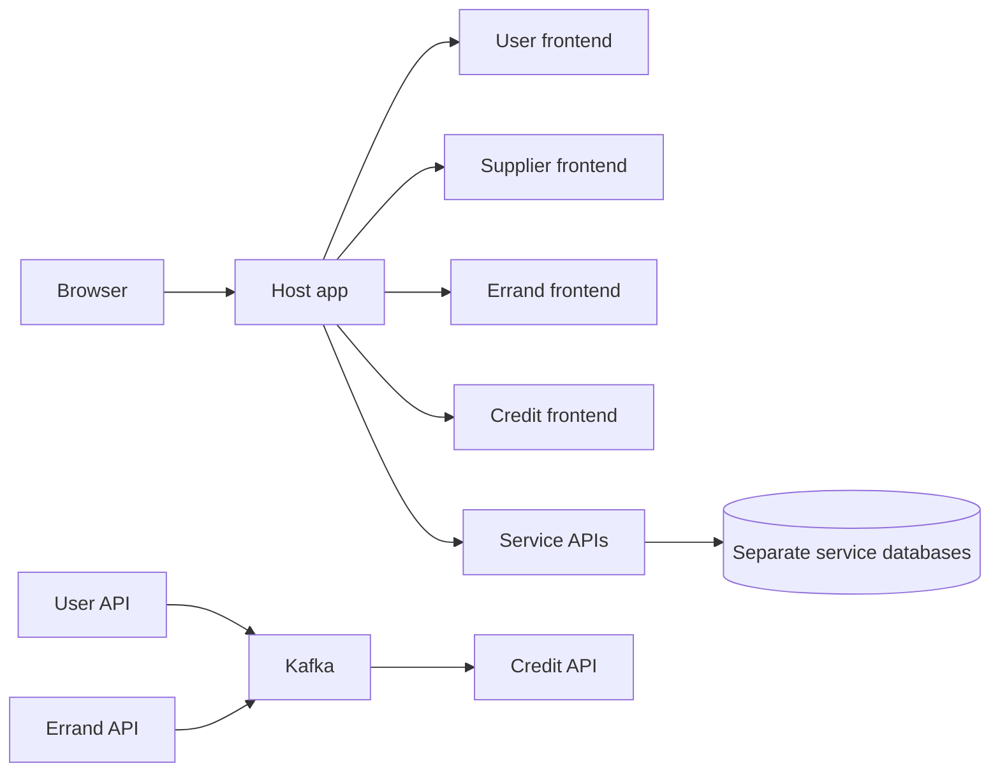

# Codex Log for Credit Frontend Implementation

- User: Cai Zhouxuan, @CZX123
- Model: GPT-6 Sol

This log contains all the prompts made for the credit frontend implementation.

Note that while the term "architecture" was used for the first prompt, it is only for Codex to map out the project structure as well as the existing frontend implementation so that I can verify correctness, and not for Codex to suggest architectural changes.

## 👤 User [2026-10-17 10:41:53]

I plan to add frontend UI components to the credit service in this project. Before that, can you first look through the entire project and explain the overall architecture? And then look into more detail the implementation of the frontend?

## 🤖 Agent [2026-10-17 10:41:56]

I’ll map the repository and its service boundaries, then trace how the frontend is built and how it talks to the credit service. I’ll base the explanation on the code and configuration in this checkout.

## 🤖 Agent [2026-10-17 10:42:21]

The project is organized as four domain services plus a host app. Each service owns a frontend remote; the APIs and data stores sit behind the host’s same origin routing. I’m now tracing the host’s navigation and shared UI contracts, then I’ll connect those to the credit frontend’s current state.

## 🤖 Agent [2026-10-17 10:43:24]

## Overall architecture

Relay is a campus errand platform split into four domain services: **User**, **Supplier**, **Errand**, and **Credit**. Each service owns a backend and a React frontend. The repository uses npm workspaces, with shared types in [packages/contracts](/home/czx/Relay/packages/contracts/src/index.ts) and reusable components and styles in [packages/ui](/home/czx/Relay/packages/ui/src/index.tsx).

The **host is the browser entry point**. It loads each frontend as a Module Federation remote and passes shared state and callbacks to them. The backends are separate Express services. User, Errand, and Credit use Prisma with their own PostgreSQL databases; Supplier uses its own PostgreSQL database. Kafka carries user and errand events to Credit: registration allocates initial credits, while errand outcomes release or transfer reserved credits. The deployment wiring is in [compose.yaml](/home/czx/Relay/compose.yaml), and the intended local workflows are described in [README.md](/home/czx/Relay/README.md).

## Frontend implementation

The host’s [App.tsx](/home/czx/Relay/host/src/app/App.tsx) owns the active service, authenticated profile, navigation, profile overlay, and shared map state. It renders all four remotes and hides inactive ones, preserving each remote’s React state during navigation. [RemoteRegistry.ts](/home/czx/Relay/host/src/remote/RemoteRegistry.ts) maps service names to remote entries; [RemoteLoader.ts](/home/czx/Relay/host/src/remote/RemoteLoader.ts) loads them; [RemotePage.tsx](/home/czx/Relay/host/src/remote/RemotePage.tsx) supplies loading and error states.

The contract between host and remotes is `RemoteAppProps` in [packages/contracts/src/index.ts](/home/czx/Relay/packages/contracts/src/index.ts). It provides optional session and profile data, navigation callbacks, API adapters for Errand and Supplier, and map state. The established frontends use those props alongside `@relay/ui` components and service-specific CSS. User handles login and account views; Supplier and Errand contain the map, lists, detail cards, and forms.

## Credit frontend: current state and integration points

The credit remote is registered and deployable, but its [App.tsx](/home/czx/Relay/credit-service/frontend/src/App.tsx) currently renders only **“Hello, World”**. Its [Vite configuration](/home/czx/Relay/credit-service/frontend/vite.config.ts) exposes `./App` as `creditFrontend` on port 5004. It has no balance or history components, API client, or use of host props yet. Its local [styles.css](/home/czx/Relay/credit-service/frontend/src/styles.css) is also not imported by `App.tsx`.

The backend already offers authenticated `GET /api/credit` for the balance and `GET /api/credit/history` for transactions, defined in [credit.routes.ts](/home/czx/Relay/credit-service/backend/src/routes/credit.routes.ts). Response shapes are in [credit responses.ts](/home/czx/Relay/packages/contracts/src/credit/responses.ts). Authentication is checked from the session cookie through the User service.

Two wiring gaps matter before a browser UI can use those endpoints:

- The host proxies `/api/user`, `/api/supplier`, and `/api/errands`, but **does not proxy `/api/credit`** in either [Nginx](/home/czx/Relay/host/config/nginx.conf) or [Vite](/home/czx/Relay/host/vite.config.ts).
- The root `npm run dev` starts the credit frontend, but its [backend command](/home/czx/Relay/package.json) does **not start the credit API or credit PostgreSQL**. The Docker Compose topology does include both.

A practical next step is to add the host credit API proxy and local backend startup, then build the credit balance and transaction history UI against the existing contracts. The host can already mount that UI; a visible navigation entry to Credit will also need to be added, since the current frontend navigation does not call `navigateTo('credit')`.

## 👤 User [2026-10-17 10:47:00]

Before adding the credit UI and api proxy, can you first find out how the User Profile UI's are being handled? The host does load the user service frontend initially during login process, but after login, it's UI is now an overlay on the top right that opens on clicking the user profile button on the top right. Can you find all implementation of the user profile button, and which service the button lies in? I will plan to mirror the same implementation for the credit UI, as another overlay on the top left instead. There will be no need for full screen credit navigation unlike the user login screens.

## 🤖 Agent [2026-10-17 10:47:03]

I’ll trace the profile button from where it renders through its click handler, host state, and overlay layout. I’ll also identify what the credit UI can reuse for a top-left overlay without a full-screen view.

## 🤖 Agent [2026-10-17 10:47:35]

Yes. The **profile button belongs to the Supplier and Errand frontends**, while the **host owns the overlay** and the **User frontend supplies its contents**.

| Part | Implementation |
| --- | --- |
| Button on the Supplier map | [supplier-service/frontend/src/App.tsx](/home/czx/Relay/supplier-service/frontend/src/App.tsx:203) |
| Button on the Errand map | [errand-service/frontend/src/App.tsx](/home/czx/Relay/errand-service/frontend/src/App.tsx:132) |
| Shared button styling | [packages/ui/src/styles/components.css](/home/czx/Relay/packages/ui/src/styles/components.css:68) and [map.css](/home/czx/Relay/packages/ui/src/styles/map.css:10) |
| Overlay state and placement | [host/src/app/App.tsx](/home/czx/Relay/host/src/app/App.tsx:203) |
| Overlay wrapper | [host/src/remote/RemotePage.tsx](/home/czx/Relay/host/src/remote/RemotePage.tsx:74) |
| Profile contents and close button | [user-service/frontend/src/app/App.tsx](/home/czx/Relay/user-service/frontend/src/app/App.tsx:202) |

The flow is:

1. The Supplier or Errand button measures its own position with `getBoundingClientRect()` and calls the host supplied `openProfile(anchor)` callback.
2. The host sets `profileOpen` and stores that anchor. It keeps the map service active, but makes the User remote visible as an overlay. It passes `presentation: 'card'` and `closeProfile` to the User remote.
3. `RemotePage` wraps the User remote in an anchored `RelayCardAnchor` and `GlassCard`. Host CSS gives the card its scroll limit and lets it receive pointer events while the surrounding overlay does not.
4. In card presentation, the User app renders a header and `AccountPage` instead of its full-screen login layout. Its close button calls the host’s `closeProfile()`.

For Credit, the **existing “Credits / 0 cr” button is already at the top left** of both map frontends: [Supplier](/home/czx/Relay/supplier-service/frontend/src/App.tsx:182) and [Errand](/home/czx/Relay/errand-service/frontend/src/App.tsx:128). Both currently have no click handler and display a hard-coded balance. Those are the natural triggers for a credit overlay.

To mirror the profile behavior, add an `openCredit(anchor)` callback to `RemoteAppProps`, have those two buttons call it, and let the host show the Credit remote as an anchored card while keeping the current map active. The Credit app can then render only card content with a close callback; it does not need a full-screen presentation or `navigateTo('credit')`. For top-left placement, anchor the card from the button’s **left edge** rather than using the profile card’s right-edge calculation.

## 👤 User [2026-10-17 10:52:06]

Now, can you first make the credit button in both frontends display the actual credit balance? Add the credit api proxy and call the correct method, similar to how the user button displays the user profile image and display name.

## 🤖 Agent [2026-10-17 10:52:10]

I’ll use the postman:api-engineer skill to check the credit endpoint and its contract, then wire the host proxy and both map buttons to the live balance. I’ll follow the existing session and refresh patterns in the frontends.

## 🤖 Agent [2026-10-17 10:52:33]

The credit endpoint returns the authenticated user’s `availableCredit`, which is the right value for the button. I’ll fetch it once in the host, pass it to both map frontends like `userProfile`, and refresh it when the session or active map view changes. The local dev command also needs the credit API and database started for this to work outside Compose.

## 🤖 Agent [2026-10-17 10:53:54]

The buttons now read the same host managed balance value, and both proxies point at the existing `GET /api/credit` route. I’m checking the development startup path and build next, since a correct proxy alone won’t produce a balance if the credit backend is absent locally.

## 🤖 Agent [2026-10-17 10:56:38]

Both map credit buttons now display the authenticated user’s **available credit** from `GET /api/credit`, supplied through the host like the user profile data. They show `... cr` while the balance is unavailable, rather than a hard-coded `0 cr`.

I added the credit API proxy to the host’s [Vite configuration](/home/czx/Relay/host/vite.config.ts:32) and [Nginx configuration](/home/czx/Relay/host/config/nginx.conf:52), and updated [npm dev startup](/home/czx/Relay/package.json) to include the credit database and API. This does not add credit navigation or an overlay.

The JSON configuration parses and `git diff --check` passes. I could not verify the UI against a running service: the Relay environment was not running, and the available Windows build command could not resolve the workspace packages.

## 👤 User [2026-10-17 11:06:23]

Introduce a function within the host that invalidates the credit balance, as the credit balance is due for an update soon but the server may not have finished it yet. If credit balance is invalidated, the host will then do polling every second for the credit balance until a new value shows up. If credit balance is unavailable intially, it will also count as invalidated. Eventually, when errand finishes/expires/cancels, the invalidation will also be called to get latest credit balance values, but focus on unavailable credit balance for now.

## 🤖 Agent [2026-10-17 11:06:27]

I’ll add a host-owned invalidation function and use it when the first balance request has no usable result. The host will retry once a second until it receives a balance, while keeping the existing balance prop available to both buttons. I’ll keep the function ready for errand events to call later. I’m using the postman:api-engineer workflow to check the endpoint behavior as I make the change.

## 🤖 Agent [2026-10-17 11:07:38]

The host now keeps the last balance visible during invalidation and retries `/api/credit` every second until the response differs in amount or `lastUpdated`. If there is no balance yet, the first successful response ends polling. I’m checking the effect cleanup and TypeScript syntax so retries stop on logout, a newer invalidation, or unmount.

## 🤖 Agent [2026-10-17 11:08:13]

The host now has an `invalidateCreditBalance()` callback in [App.tsx](/home/czx/Relay/host/src/app/App.tsx). It keeps the displayed balance while checking `/api/credit` once per second, and stops when the balance amounts or `lastUpdated` change. An initially unavailable balance also triggers polling; its first successful response stops the retries.

The callback is available to remotes through [RemoteAppProps](/home/czx/Relay/packages/contracts/src/index.ts). Errand actions do not call it yet, as requested. Polling is cleaned up on logout, a newer invalidation, or unmount.

TypeScript syntax checks and `git diff --check` passed. I could not verify polling against a live credit service because the local environment was not running.

## 👤 User [2026-10-17 11:11:03]

Is there a function to display an error message?

## 🤖 Agent [2026-10-17 11:11:07]

Yes. The shared UI package exports [`ErrorMessage`](/home/czx/Relay/packages/ui/src/ErrorMessage.tsx), which the User frontend uses for API errors.

The **credit balance flow does not use it yet**. Its host fetch catches errors and keeps retrying silently; the buttons show `... cr` until a balance is available.

## 👤 User [2026-10-17 11:11:32]

Is there a function provided by the host to display a message on screen as a form of notification?

## 🤖 Agent [2026-10-17 11:11:35]

I’ll check the host’s props and UI components for a notification callback, so I can distinguish a host-wide message from an error shown inside one remote.

## 🤖 Agent [2026-10-17 11:11:45]

No. The host currently has **no notification or toast function** that a frontend can call through `RemoteAppProps`.

[`ErrorMessage`](/home/czx/Relay/packages/ui/src/ErrorMessage.tsx) is a shared component that each frontend renders within its own UI. The host itself only displays loading and remote failure states in [RemotePage.tsx](/home/czx/Relay/host/src/remote/RemotePage.tsx).

## 👤 User [2026-10-17 11:14:57]

Set a limit to the polling, around 20 tries. After which, just log the error into the console for now.

## 🤖 Agent [2026-10-17 11:15:02]

I’ll cap each credit balance polling run at 20 requests, one second apart. If none returns a new balance, the host will stop retrying and log an error; a later invalidation can start a new run.

## 🤖 Agent [2026-10-17 11:15:59]

Credit balance polling now stops after **20 attempts**, one second apart. If no new balance appears, the host logs the last failure to the console. A later invalidation starts a fresh polling run.

TypeScript syntax and `git diff --check` passed.

## 👤 User [2026-10-17 11:21:13]

Now add the actual credit overlay. First, can you tell me how the user profile overlay is being implemented?

## 🤖 Agent [2026-10-17 11:21:23]

The profile overlay is assembled across three places:

1. **The button lives in the Supplier and Errand frontends.** Each profile button measures its position with `getBoundingClientRect()` and calls the host supplied `openProfile(anchor)` callback: [Supplier](/home/czx/Relay/supplier-service/frontend/src/App.tsx:93), [Errand](/home/czx/Relay/errand-service/frontend/src/App.tsx:74).

2. **The host owns the overlay state.** `openProfile` stores the button’s position and sets `profileOpen`. The host keeps the map service active while making the User remote visible with `overlay`, `card`, and `presentation: 'card'` props. It calculates a position below the button, aligned to its right edge: [host App.tsx](/home/czx/Relay/host/src/app/App.tsx:225).

3. **The wrapper and content have separate jobs.** [RemotePage.tsx](/home/czx/Relay/host/src/remote/RemotePage.tsx:74) places the User remote inside `RelayCardAnchor` and `GlassCard`; [host App.css](/home/czx/Relay/host/src/app/App.css:14) controls the overlay layer and scrolling. With `presentation: 'card'`, the [User app](/home/czx/Relay/user-service/frontend/src/app/App.tsx:202) renders its profile header, close button, and `AccountPage` instead of its full-screen login view. The close button calls the host’s `closeProfile`.

For Credit, the two existing top-left credit buttons can provide the anchor in the same way. The host would own `creditOpen` and position the Credit remote below the button, aligned to its **left edge**. The Credit app would render only card content, since it has no login or full-screen flow.

## 👤 User [2026-10-17 11:24:14]

Add the same functions for the credit overlay. The credit overlay does not need a presentation attribute since it will not offer a full screen view. Ensures that the button press will open the credit profile screen below the button. The credit screen will follow a similar styling to the user profile overlay, with the first section containing the user's available balance and reserve balance, followed by a divider, then the next section containing just a button to view credit history. Don't implement this button for now.

## 🤖 Agent [2026-10-17 11:24:20]

I’ll connect both top-left credit buttons to a host-owned overlay, then build the Credit remote’s card content from the balance the host already fetches. I’ll use the profile card’s wrapper and place the credit card below its button, aligned to the left.

## 🤖 Agent [2026-10-17 11:26:54]

The host now has separate Credit overlay state and a left-aligned anchor calculation. The buttons pass their screen position to it, and opening Credit closes the profile card. I’m finishing the card content and checking the small-screen placement.

## 🤖 Agent [2026-10-17 11:29:05]

The credit overlay is in place. The credit button in both the Supplier and Errand frontends opens a card below the button, aligned to its left edge. The host owns its open and close state, and opening another view closes it.

The card uses the profile overlay’s glass styling. It shows the **available** and **reserve** balances, a divider, and a disabled **View credit history** button. Credit has no full-screen presentation.

Syntax checks passed for the changed TypeScript files, and `git diff --check` passed. I did not verify the overlay in a running browser.

## 👤 User [2026-10-17 11:35:02]

can you do a npm run dev and fix any errors that occur, or spin up necessary docker containers for the local frontend to work? I want to see it in the browser while still supporting npm run dev features like hot reload

## 🤖 Agent [2026-10-17 11:35:06]

I’ll check which Node, Docker, and repository dependencies are available, then start the infrastructure and the Vite development processes. I’ll fix startup errors as they appear and leave the hot reload processes running so you can open the app in your browser.

## 🤖 Agent [2026-10-17 11:35:42]

Docker is available, and the repo has dependencies, but WSL is currently finding the Windows npm executable while Linux `node` is absent from `PATH`. I found a Linux Node binary installed with VS Code. I’ll use that for the dev scripts and bring up the databases and Kafka first.

## 🤖 Agent [2026-10-17 11:38:25]

The Vite servers started, but the combined command shut them down when Prisma generation failed: the installed Prisma engine directory is owned by root, so the dev user cannot write its generated engine file. I’m checking that directory and the existing client artifacts, then I’ll repair the local permissions needed for startup and rerun the command.

## 🤖 Agent [2026-10-17 11:41:51]

The permission issue is fixed. The next startup error is a fresh database case: the Errand backfill runs before Prisma creates the `errands` table. I’ll make that backfill skip databases where the table does not exist yet, then let `db push` create the schema.

## 🤖 Agent [2026-10-17 11:43:22]

The fresh Errand database now initializes successfully, and both Errand and Credit Prisma clients generate. I’m waiting for the credit migration and API processes to settle, then I’ll start the frontends with hot reload and check the browser entry point.

## 🤖 Agent [2026-10-17 11:45:29]

All five Vite servers are up. The repository’s frontend access test was checking for `App` directly inside `remoteEntry.js`, while this Vite dev build puts the exposure in an imported map. I updated that check to follow the map. I’m confirming the backend health routes and rerunning the test now.

## 🤖 Agent [2026-10-17 11:46:53]

The host and all four remote entries now pass the frontend access test through `http://localhost:8080`. The backends are finishing their startup sequence. I also fixed a missing Kafka topic setting in the local User API command; I’m checking its health endpoint and the credit proxy before I hand you the URL.

## 🤖 Agent [2026-10-17 11:49:01]

The development stack is running: all four APIs report healthy, the credit proxy returns the expected `401` without a login session, and the five frontend access checks pass. I’m opening the host URL in your browser now; the Vite and watch processes will remain running for hot reload.

## 🤖 Agent [2026-10-17 11:49:29]

Relay is running at **[http://localhost:8080](http://localhost:8080)**, and I opened it in your browser. The Vite and backend watch processes are still running, so edits should hot reload.

I fixed three local startup issues: Prisma generated-file ownership, the Errand backfill failing on a fresh database, and the User API’s missing Kafka settings. I also updated the frontend access check for Vite’s development remote format.

All five frontend access checks pass, all four APIs report healthy, and the host returns HTTP 200. This WSL session used a temporary Linux Node/npm launcher because its default npm points to Windows; a future terminal session will need Linux Node on `PATH` to run `npm run dev` directly.

## 👤 User [2026-10-17 12:00:39]

Remove the divider inside the credit overlay, and ensure the background of the 2 balances is consistent with the background of the email within the personal details section inside the user profile overlay

## 🤖 Agent [2026-10-17 12:00:46]

I’ll compare the credit balance cards with the User profile’s email field, then update the credit styles to use the same surface treatment and remove the divider.

## 🤖 Agent [2026-10-17 12:02:04]

Removed the divider. The two balance cards now use the same padding, border, radius, background, and backdrop filter as the email row in the User profile.

The running Vite server picked up both changes through hot reload. `git diff --check` passed.

## 👤 User [2026-10-17 12:12:28]

Now, add the credit history screen. It will need a larger space than the current overlay size, so you may need to add another method to remote app props to show credit history and animate the increase in width and height of the credit overlay. Display the credit transactions record as is when fetched from the credit backend, as they will already be in descending order of time. Use pagination so that there is no horizontal scrolling at all, only some vertical scrolling for the table on very small screens where the transaction record cannot fit on the smaller widths. Within each transaction record row, display the time, type of transaction, and amount involved. The amount should have + signs for credit release and incoming transfer, and - signs for credit reserve and outgoing transfer. The color should be green for incoming transfer, red for outgoing transfer, and neutral gray for credit reserve/release.

## 🤖 Agent [2026-10-17 12:12:37]

I’ll use the postman:api-engineer workflow for the history endpoint and response shape. Then I’ll add a history view inside the Credit remote, have the host enlarge the anchored card when it opens, and keep the backend’s transaction order while paginating the rows.

## 🤖 Agent [2026-10-17 12:13:23]

The backend already returns history in descending time order, so the UI will paginate the returned array without sorting it. I’ll make the host own whether the credit card is showing balance or history; that lets closing and reopening the card reset it cleanly while its width and height animate.

## 🤖 Agent [2026-10-17 12:16:37]

The history view now fetches `GET /api/credit/history`, displays ten records per page, and leaves the server’s order unchanged. Amount signs and colors come from each record’s type and whether the signed-in user sent or received a transfer. I’m running the host and Credit frontend builds now to catch type or layout integration errors.

## 🤖 Agent [2026-10-17 12:18:10]

The Credit frontend and host builds pass, and the transaction sign and color rules pass focused tests. I’m checking one pagination edge case now: if refreshed history has fewer pages, the view should stay on a valid page. I’ll also confirm the running Vite host picked up the changes.

## 🤖 Agent [2026-10-17 12:19:33]

The credit history view and overlay resize are implemented. I’m running the final build and checks now, then I’ll confirm the dev server is still serving the updated frontend.

## 🤖 Agent [2026-10-17 12:20:05]

The credit overlay now opens a larger history screen and animates its width and height. It fetches transactions from the credit backend, keeps their returned order, and shows 10 records per page. Each row shows the time, transaction type, and signed amount, with green incoming transfers, red outgoing transfers, and gray reserve and release entries. The table fits narrow widths without horizontal scrolling.

The credit frontend and host builds pass, both history display tests pass, and the dev server is serving at [localhost:8080](http://localhost:8080). I could not verify a populated history in the browser without an authenticated session.

## 👤 User [2026-10-17 12:23:56]

Improve the transition from credit view to credit history view. Use easing and faster animation timings for the width and height transition. Rapidly fade out the outgoing view and slowly fade in the incoming view. Use CSS to control all transitions.

## 🤖 Agent [2026-10-17 12:23:58]

I’ll inspect the current overlay and view styles, then adjust the resize and crossfade in CSS while keeping the existing credit history behavior.

## 🤖 Agent [2026-10-17 12:24:40]

The two views currently replace each other immediately, so CSS has no outgoing content to fade. I’m keeping both view panels mounted and letting CSS handle their visibility and timing; the history request will still run only when history is selected.

## 🤖 Agent [2026-10-17 12:26:21]

The credit overlay now resizes with a faster 190 ms eased transition. When switching views, the outgoing content fades out quickly and the incoming content fades in more gradually. CSS controls both effects, including a reduced motion setting.

The credit frontend and host builds pass.

## 👤 User [2026-10-17 12:34:39]

Instead of a back to history button, use the back button with the left arrow symbol as done in the user profile page change password page. Place the back button on the left side of the credit history title.

## 🤖 Agent [2026-10-17 12:34:41]

I’ll match the back control used on the user profile’s change password screen and place it beside the Credit history title.

## 🤖 Agent [2026-10-17 12:35:34]

The Credit history header now uses the same left arrow `IconButton` as the user profile’s change password screen, positioned immediately to the left of the title. The credit frontend build passes.

## 👤 User [2026-10-17 12:36:31]

When going to credit history screen, also animate the background of the overlay to be the same color as the background of the 2 balances, for better visibility

## 🤖 Agent [2026-10-17 12:36:35]

I’ll use the balance panels’ existing background token for the overlay in history mode and add a CSS color transition to match the current resize and fade.

## 🤖 Agent [2026-10-17 12:39:20]

The credit overlay now animates to the same background color used by the balance panels when history opens, and animates back when returning to the balance view. This also applies on small screens and respects reduced motion settings. The host build passes.

## 👤 User [2026-10-17 12:43:41]

Sorry, not the exact same color as the balance background as that is only a light opacity background on top of another background. Instead, use the previous background color but with opacity set to .95 instead, or if you can find a color variable that has a higher value opacity, then use that. Also, check through the relay design system inside the shared package, and see if any more custom styles defined in credit service can be handled by the existing shared styles.

## 🤖 Agent [2026-10-17 12:43:44]

I’ll check the shared glass surface tokens and components, then update the history background and remove credit styles that duplicate existing design system styles.

## 🤖 Agent [2026-10-17 12:44:11]

The shared package has a reusable `.relay-glass-soft` style for nested panels, which fits the two balance panels. It has no high opacity surface token, so I’ll add a 0.95 variant for the history overlay and use the shared class for the balance panels.

## 🤖 Agent [2026-10-17 12:45:06]

The history overlay now transitions from the original glass surface to a new 0.95 opacity version of that color. I added the color as a shared design system token.

I also switched the two balance panels to the shared `.relay-glass-soft` style and removed their duplicate glass styling from the credit stylesheet. The table layout and view transitions still need credit-specific CSS. The credit frontend and host builds pass.

## 👤 User [2026-10-17 12:50:01]

Add some dummy data directly to credit db to show credit history. Add enough data for pagination to work.

## 🤖 Agent [2026-10-17 12:50:05]

I’ll inspect the credit database schema and the local data setup, then seed enough transactions for multiple history pages. I’ll leave existing records intact.

## 🤖 Agent [2026-10-17 12:51:14]

The local credit database has one balance record for the same user present in the user database. I’m adding 25 idempotent demo transactions for that account, with all four history display types represented. That gives the UI three pages at its current page size.

## 🤖 Agent [2026-10-17 12:51:40]

I added 25 dummy transactions to the local credit database for the existing user. The account now has 26 history records, enough for three pages. The demo rows cover reserves, releases, incoming transfers, and outgoing transfers.

The seed is idempotent, so rerunning it will not duplicate those rows. It changes history records only; the displayed balances are unchanged. Refresh the app and open Credit history to see them.

## 👤 User [2026-10-17 13:18:11]

Correction: the credit history table should not have vertical scrolling on most screens. Make the spacing between the rows adapt to the given space of the credit history height, and there should only be vertical scrollbar on screens with very low heights, so set a min-height on the table. Instead, each cell should only occupy one line, and have a horizontal scrollbar for rows that are too long.

## 🤖 Agent [2026-10-17 13:18:21]

I’ll make the table fill the available history height so its rows spread out on normal screens. I’ll also keep each cell to one line and allow horizontal scrolling when the content needs more width.

## 🤖 Agent [2026-10-17 13:19:23]

The history table now fills the available overlay height, so row spacing expands on typical screens. A 400 px minimum table height makes vertical scrolling appear when the overlay is too short.

Cells stay on one line, and the table can scroll horizontally when its contents exceed the width. The scrollable area is keyboard accessible. The credit frontend build passes.

## 👤 User [2026-10-17 13:23:15]

There are still vertical scrollbars appearing. Please use css flexbox instead of a html table for even dynamic spacing between rows.

## 🤖 Agent [2026-10-17 13:23:26]

I’ll replace the table markup with flex rows so the records can share the available height evenly. I’ll keep a small row minimum for short screens and preserve horizontal scrolling for one-line values.

## 🤖 Agent [2026-10-17 13:24:35]

I replaced the HTML table with CSS flex rows. The rows now divide the available height evenly, so normal sized overlays should no longer show a vertical scrollbar. On short screens, rows keep a 32 px minimum and the list can scroll vertically. Cells stay on one line, with horizontal scrolling on narrow screens.

The credit frontend build passes.

## 👤 User [2026-10-17 13:27:12]

Always have 10 rows with flexbox so last page won't spread the remaining rows unnaturally

## 🤖 Agent [2026-10-17 13:27:16]

I’ll render empty row slots up to ten on the last page. That will keep row heights consistent across pages without adding fake transactions.

## 🤖 Agent [2026-10-17 13:27:53]

Credit history now keeps ten flex row slots on every page. The last page fills unused slots with empty, screen reader hidden rows, so its records keep the same spacing as earlier pages. The credit frontend build passes.

## 👤 User [2026-10-17 13:29:21]

Don't set fixed widths for each column. Make widths also dynamic under flexbox, and set event spacing between them. The final column width should be the width of the largest cell.

## 🤖 Agent [2026-10-17 13:30:00]

I’ll remove the hardcoded column widths. Flexbox will share the remaining space between time and transaction, with equal gaps, while the amount column will size to the widest visible amount.

## 🤖 Agent [2026-10-17 13:31:34]

The history columns no longer have hardcoded widths. Flexbox shares the available space between Time and Transaction with even gaps, and Amount uses the width of its widest visible cell. The ten row slots and horizontal scrolling remain in place.

The credit frontend build passes.

## 👤 User [2026-10-17 13:41:09]

Don't use layout effects in React, flexbox has fit content and align-items. Use css to achieve the same effect.

## 🤖 Agent [2026-10-17 13:41:18]

I’ll remove the React measurement and let CSS size the amount cells by their content. The flex rows will keep the amounts aligned at the right edge.

## 🤖 Agent [2026-10-17 13:42:17]

I removed the React layout effect and width measurement. CSS now sizes each amount to its content and aligns amounts at the right edge; flexbox handles the spacing. The credit frontend build passes.

## 👤 User [2026-10-17 13:47:03]

Sorry, instead of display flex, use display grid, so that the columns match

## 🤖 Agent [2026-10-17 13:47:13]

I’ll switch the history list to one CSS grid so every row shares the same column widths. The ten row slots will still divide the available height evenly.

## 🤖 Agent [2026-10-17 13:48:16]

Credit history now uses CSS Grid with shared columns, so Time, Transaction, and Amount align across every row. The Amount column sizes to its widest cell. Ten row slots still share the available height, and narrow screens can scroll horizontally. The credit frontend build passes.

## 👤 User [2026-10-17 14:15:49]

Update the credit history request contract. First, add a new offset number field to the ViewCreditHistoryRequest model that is a number. Then, document that credit history records now are only limited to 100, so the offset is required for db to skip the amount of rows specified by the offset. Now, the get request will now accept the optional query /api/credit/history?offset={number}, and that will be mapped to the offset number in the request. If none is specified, offset is 0. Change the db call to limit number of rows to 100. Finally, in the frontend, once the 100 row threshold has passed, the frontend memory will store the new section of 100 rows at a time, automatically making new get requests.

## 🤖 Agent [2026-10-17 14:15:54]

I’ll update the shared request contract, backend pagination, and frontend batch loading together. I’m using the Postman API engineering workflow for this change, then I’ll run the relevant checks.

## 🤖 Agent [2026-10-17 14:17:05]

The API contract currently returns all records, while the frontend paginates only in memory. I’ll cap each backend response at 100 records, validate the offset query, and have the frontend fetch the next batch when the user moves beyond the loaded pages.

## 🤖 Agent [2026-10-17 14:19:47]

The contract, backend limit, and frontend batch loading are in place. I’m running the credit HTTP tests now, including checks for 100 records per response, offset 100, and invalid offsets.

## 🤖 Agent [2026-10-17 14:22:06]

The backend build could not update its generated `dist` files because they are owned by root from an earlier container run, so the HTTP test picked up old code. I’ll fix the ownership of that generated directory, rebuild, and rerun the tests.

## 🤖 Agent [2026-10-17 14:25:35]

Credit history now accepts an optional `offset` query parameter, defaulting to 0. The backend skips that many records and returns at most 100 in descending order. The frontend keeps each fetched batch in memory and requests the next 100 when the user advances past the loaded pages. I updated the contract and API documentation.

Both builds pass, as do all 13 credit HTTP tests and the frontend history tests. The full backend suite has one remaining failure: its Kafka event test cannot resolve the local broker hostname.

## 👤 User [2026-10-17 14:34:25]

Add 200 more transaction records to test in the live browser build

## 🤖 Agent [2026-10-17 14:34:32]

I’ll add 200 more demo transactions to the local credit database for the existing user, then verify that the history has enough records to cross two 100-record fetch boundaries.

## 🤖 Agent [2026-10-17 14:35:24]

I added 200 more demo transactions to the existing user’s local credit database. History now has 226 records, giving the browser 100 records at offset 0, 100 at offset 100, and 26 at offset 200.

The dev app is serving at [localhost:8080](http://localhost:8080). Refresh it and open Credit history to test loading across all three batches.

## 👤 User [2026-10-17 16:15:14]

setCreditBalance is called directly within a useEffect hook in the host, causing lint errors, can you fix this?

## 🤖 Agent [2026-10-17 16:15:20]

I’ll find the balance effect, adjust it so the state update follows the host’s React lint rule, then run the host lint and build checks.

## 🤖 Agent [2026-10-17 16:17:00]

Fixed the host lint error. The displayed balance is now derived from the stored balance and authenticated user, so the effect no longer clears it synchronously. The host still clears stored credit on sign-out or session failure.

Host lint and build both pass.

## 👤 User [2026-10-17 16:22:07]

Can you do a PR review and analysis of all changes made? Note that there are new changes from main that integrates errand & credit service together, so all functions should now work. After that, do a full compose down with volumes removed, and do a docker compose up of the full system to test the end-to-end integration. Provide a postman config that includes all functions for errands and credits, which also includes the user authentication flows that can obtain the relevant session cookies. Leave the docker containers running so I can also test it from the live frontend.

## 🤖 Agent [2026-10-17 16:22:15]

I’ll review the current branch against main and trace the errand, credit, and authentication paths first. Then I’ll build a runnable Postman collection, reset the Compose environment as requested, bring up the full stack, and run integration checks. I’ll leave the containers running.

## 🤖 Agent [2026-10-17 16:23:10]

The branch includes the merged errand and credit integration. I’m checking the new reserve, event, and outbox paths for review findings while I map the public requests for the collection. I’ll also confirm the actual login and cookie behavior before the Compose reset.

## 🤖 Agent [2026-10-17 16:25:07]

The current Compose project has no running containers, so the requested volume reset is straightforward. I’ve mapped the public errand and credit routes and am bringing up the full stack now; then I’ll exercise the flows through the host, including session cookie handling and credit events.

## 🤖 Agent [2026-10-17 16:26:40]

The image build is progressing through the service and frontend builds. I’m preparing a collection that registers two users, captures each session cookie, runs the errand lifecycle, and checks credit balances and history through the host URL.

## 🤖 Agent [2026-10-17 16:28:38]

All backend images built successfully, and the services are becoming healthy. I found a likely review concern in the errand status writes: they update by ID after a separate state check, which could allow concurrent lifecycle requests to overwrite each other. I’ll validate the normal end-to-end path first and report that separately with its exact impact.

## 🤖 Agent [2026-10-17 16:30:12]

The live end-to-end run now passes: two users registered and obtained cookies, profile events allocated 100 credits each, an errand reserved 10 credits, and the courier completed it. The final balances were 90 for the requester and 110 for the courier, with history entries returned for both. The first balance read briefly returned 404 before the allocation event arrived, so I’m making the collection account for that asynchronous startup.

## 🤖 Agent [2026-10-17 16:32:52]

The automated suite needed the Compose database and Kafka settings plus a fresh local credit build; with those supplied, all 23 credit tests pass. Lint also passes. I’m finishing the review findings and a final container/collection check, then I’ll leave the stack running at the host URL.

## 🤖 Agent [2026-10-17 16:33:57]

**PR review:** The main integration path works in the live stack. I found one concurrency issue to address before merging: [errand.repository.ts](/home/czx/Relay/errand-service/backend/src/repositories/errand.repository.ts:210) updates lifecycle states by errand ID after a separate state check. Two simultaneous requests can both pass that check and overwrite each other, potentially emitting conflicting credit events. The status and expected current state should be checked in the same database update.

I ran the requested `docker compose down --volumes --remove-orphans`, then rebuilt and started the full stack. **The containers are running**; the frontend is at **http://localhost:8080**. Live checks covered registration, verification, session cookies, initial credit allocation, errand creation and completion, credit transfer, cancellation, drop, deletion, balances, and history. The completed errand moved 10 credits: requester **100 → 90**, courier **100 → 110**. Lint and the full test suite pass when run with the Compose database and Kafka settings.

Import both [Postman collection](/home/czx/Relay/tests/integration/relay-e2e.postman_collection.json) and [local environment](/home/czx/Relay/tests/integration/relay-compose.postman_environment.json). Run the collection in order with a **1-second request delay** to allow asynchronous credit events to settle.

## 👤 User [2026-10-17 16:40:51]

Also provide a md file that contains the keys and the values that are in all the kafka events specified in user service and errand service, so I can manually send kafka events with kafbat ui

## 🤖 Agent [2026-10-17 16:41:05]

I’ll trace the user and errand publishers alongside their event contracts, then add a Markdown reference with copyable Kafka message keys and JSON values for Kafbat UI.

## 🤖 Agent [2026-10-17 16:41:29]

The publishers use the Cognito subject as the user event key and the errand ID as the errand event key. I’ve also checked which errand events the credit consumer acts on, so the reference will distinguish a valid Kafka message from one that can actually change a balance.

## 🤖 Agent [2026-10-17 16:42:54]

Added the [Kafka event reference](/home/czx/Relay/tests/integration/kafka-events.md). It lists the topic, message key, and copyable JSON value for every user and errand service event, plus the dead letter event format and a manual credit test sequence.

Kafbat UI is at **http://localhost:8081**. The Compose containers remain running.

## 👤 User [2026-10-17 17:12:49]

Can you find where are the errand creation, errand cancellation, and possibly errand expiry callbacks in the errand service frontend? And if possible, call the invalidateCreditBalance function so that after these callbacks, the credit amount will get updated to the latest value?

## 🤖 Agent [2026-10-17 17:12:54]

I’ll trace the errand frontend’s create, cancel, and expiry paths, then connect successful credit changing actions to the host’s invalidation callback. I’ll check whether expiry has a frontend callback or is handled only by the backend.

## 🤖 Agent [2026-10-17 17:13:46]

Creation completes in `CreateErrandCard`, while cancellation and confirmation complete in `App.updateErrand`. Expiry is handled by the backend; the frontend currently has no expiry callback. I’ll invalidate after successful create, cancel, and confirm responses, and after a drop response that reports `EXPIRED`.

## 🤖 Agent [2026-10-17 17:15:12]

The callback wiring builds successfully. I’m refreshing the running errand frontend container so the browser at `localhost:8080` serves this change, then I’ll confirm the stack remains healthy.

## 🤖 Agent [2026-10-17 17:15:56]

I found the callbacks and wired the errand frontend to call the host’s `invalidateCreditBalance` after a successful **creation, cancellation, or delivery confirmation**. It also calls it when a courier drop returns `EXPIRED`. The host then polls for the updated balance.

Ordinary expiry happens in the backend; the frontend has no expiry callback, so an errand expiring without a user action does not yet trigger invalidation.

The errand frontend build passes, and I refreshed its Docker container. The stack remains running at **http://localhost:8080**. The change is in [App.tsx](/home/czx/Relay/errand-service/frontend/src/App.tsx:19).
